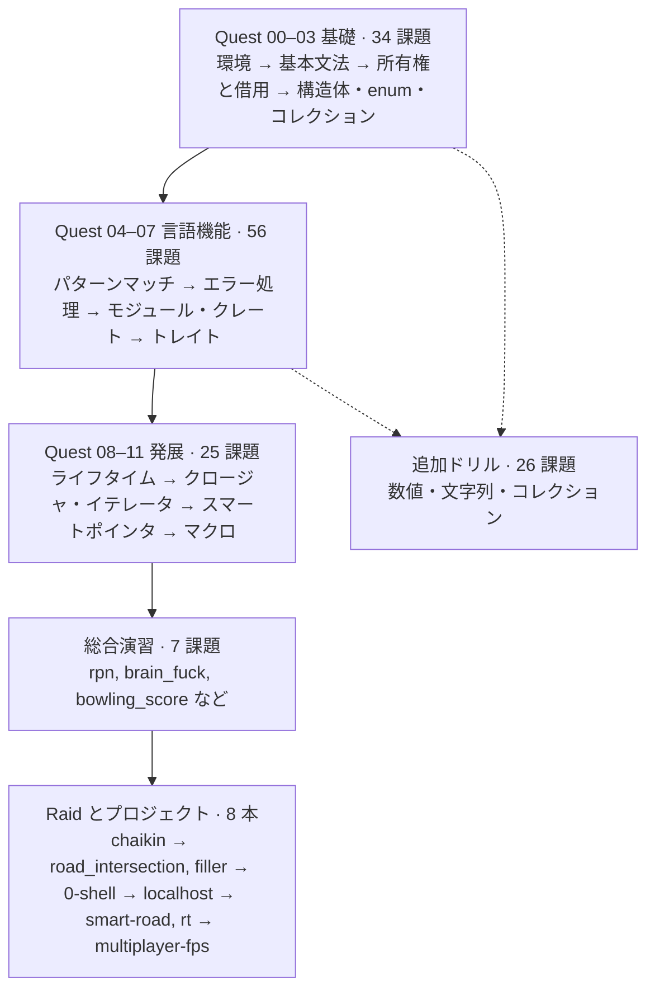

# Rust Piscine

Solutions and learning roadmap for the [01-edu Rust Piscine](https://github.com/01-edu/public/tree/master/subjects).

01-edu の subjects にある Rust 課題 148 本（hello_rust を含む）と、その後の Raid・プロジェクト 8 本を順番に解いていくためのリポジトリ。Quest 01–03 は [tnktks111/Rust-Piscine](https://github.com/tnktks111/Rust-Piscine) の順番に従い、Quest 04 以降は各課題の Notions と Rust Book の章順で並べた**提案順**（公式の Quest 番号ではない）。

## Roadmap



| 段階 | 課題数 | 順番の根拠 |
|------|-------:|------------|
| Quest 00–03 基礎 | 34 | 参考リポの実際の順番 |
| Quest 04–07 言語機能 | 56 | Rust Book の章順で提案 |
| Quest 08–11 発展 | 25 | Rust Book の章順で提案 |
| 追加ドリル | 26 | 対応する Quest の後ならいつでも |
| 総合演習 | 7 | Quest 09 の後 |
| Raid・プロジェクト | 8 | クエスト修了後 |

## Project Structure

全課題を 1 つの [Cargo Workspace](https://doc.rust-lang.org/book/ch14-03-cargo-workspaces.html) に入れ、各課題を独立した lib クレートにする。

```toml
# Cargo.toml
[workspace]
resolver = "3"
members = ["quest-*/*"]
```

```text
rust-piscine/
├── Cargo.toml
├── README.md
├── quest-01/
│   └── scalar/
│       ├── Cargo.toml
│       ├── src/lib.rs             # 解答
│       └── tests/scalar_test.rs   # 自分で書くテスト
└── quest-02/
    └── ...
```

## Workflow

1. `cargo new --lib quest-01/scalar` で作る
2. subject の README を読み、Expected functions のシグネチャをそのまま `src/lib.rs` に写す
3. README の Usage（main と期待出力）を `tests/` に `assert_eq!` で移す。panic が仕様なら `#[should_panic(expected = "...")]`
4. `cargo test -p scalar` が通るまで実装する
5. `cargo clippy -p scalar` と `cargo fmt --all` で仕上げてコミット

```bash
cargo test --workspace      # 全課題のテスト
cargo clippy --workspace    # lint
cargo fmt --all             # format
```

- 公式採点のテストは公開されていないので、README の例 ＋ 境界値（0、空文字、最大値）を自分で足す
- 詰まったら答えを見る前に、各 subject の Notions に貼られた Rust Book の章を読む

## Progress

### Quest 00 — Setup

| Exercise | Notion | Status |
|----------|--------|--------|
| [hello_rust](https://github.com/01-edu/public/tree/master/subjects/hello_rust) | リポジトリ作成、`.gitignore`（`**/target/*`） | ⬜ |

### Quest 01 — Rust Fundamentals（3 章）

| Exercise | Notion | Status |
|----------|--------|--------|
| [scalar](https://github.com/01-edu/public/tree/master/subjects/scalar) | 整数型と算術、overflow の panic | ⬜ |
| [division_and_remainder](https://github.com/01-edu/public/tree/master/subjects/division_and_remainder) | タプルで 2 値を返す | ⬜ |
| [fibonacci2](https://github.com/01-edu/public/tree/master/subjects/fibonacci2) | 関数と再帰 | ⬜ |
| [find_factorial](https://github.com/01-edu/public/tree/master/subjects/find_factorial) | 再帰／ループ | ⬜ |
| [groceries](https://github.com/01-edu/public/tree/master/subjects/groceries) | `Vec` への挿入と添字アクセス | ⬜ |
| [looping](https://github.com/01-edu/public/tree/master/subjects/looping) | 標準入力と `loop` | ⬜ |
| [matrix_transposition](https://github.com/01-edu/public/tree/master/subjects/matrix_transposition) | タプル構造体と derive | ⬜ |
| [reverse_string](https://github.com/01-edu/public/tree/master/subjects/reverse_string) | `&str` と `char` | ⬜ |
| [speed_transformation](https://github.com/01-edu/public/tree/master/subjects/speed_transformation) | `f64` の計算 | ⬜ |
| [temperature_conv](https://github.com/01-edu/public/tree/master/subjects/temperature_conv) | `f64` の計算 | ⬜ |
| [tuples_refs](https://github.com/01-edu/public/tree/master/subjects/tuples_refs) | タプル構造体と参照を返す関数 | ⬜ |

### Quest 02 — Ownership & Borrowing（4 章）

| Exercise | Notion | Status |
|----------|--------|--------|
| [ownership](https://github.com/01-edu/public/tree/master/subjects/ownership) | `String` を move で受け取る | ⬜ |
| [borrow](https://github.com/01-edu/public/tree/master/subjects/borrow) | 借用した文字列の長さ | ⬜ |
| [borrow_me_the_reference](https://github.com/01-edu/public/tree/master/subjects/borrow_me_the_reference) | 参照で受けて書き換える | ⬜ |
| [copy](https://github.com/01-edu/public/tree/master/subjects/copy) | `Copy` 型と move の違い | ⬜ |
| [doubtful](https://github.com/01-edu/public/tree/master/subjects/doubtful) | 引数の型を自分で決める | ⬜ |
| [changes](https://github.com/01-edu/public/tree/master/subjects/changes) | 構造体の配列を `&mut` で更新 | ⬜ |
| [arrange_it](https://github.com/01-edu/public/tree/master/subjects/arrange_it) | リテラルから新しい `String` を組み立てる | ⬜ |
| [name_initials](https://github.com/01-edu/public/tree/master/subjects/name_initials) | `Vec<&str>` から `Vec<String>` | ⬜ |
| [string_literals](https://github.com/01-edu/public/tree/master/subjects/string_literals) | `&str` のメソッド群 | ⬜ |
| [tic_tac_toe](https://github.com/01-edu/public/tree/master/subjects/tic_tac_toe) | 盤面を借用して勝敗判定 | ⬜ |

### Quest 03 — Structs, Enums & Collections（5・6・8 章）

| Exercise | Notion | Status |
|----------|--------|--------|
| [circle](https://github.com/01-edu/public/tree/master/subjects/circle) | `struct` と `impl` | ⬜ |
| [card_deck](https://github.com/01-edu/public/tree/master/subjects/card_deck) | `enum` | ⬜ |
| [arrays](https://github.com/01-edu/public/tree/master/subjects/arrays) | 固定長配列 | ⬜ |
| [strings](https://github.com/01-edu/public/tree/master/subjects/strings) | バイト数と文字数 | ⬜ |
| [to_url](https://github.com/01-edu/public/tree/master/subjects/to_url) | 文字列の置換 | ⬜ |
| [capitalizing](https://github.com/01-edu/public/tree/master/subjects/capitalizing) | 大文字小文字変換 | ⬜ |
| [edit_distance](https://github.com/01-edu/public/tree/master/subjects/edit_distance) | 編集距離（DP） | ⬜ |
| [hashing](https://github.com/01-edu/public/tree/master/subjects/hashing) | 平均・中央値・最頻値 | ⬜ |
| [string_permutation](https://github.com/01-edu/public/tree/master/subjects/string_permutation) | 文字の出現回数を比べる | ⬜ |
| [bigger](https://github.com/01-edu/public/tree/master/subjects/bigger) | `HashMap` の最大値 | ⬜ |
| [simple_hash](https://github.com/01-edu/public/tree/master/subjects/simple_hash) | 単語の出現回数 | ⬜ |
| [collect](https://github.com/01-edu/public/tree/master/subjects/collect) | バブルソート（`&mut [i32]`） | ⬜ |

### Quest 04 — パターンマッチと構造体の練習（5・18 章）

| Exercise | Notion | Status |
|----------|--------|--------|
| [dress_code](https://github.com/01-edu/public/tree/master/subjects/dress_code) | match とガード | ⬜ |
| [logic_number](https://github.com/01-edu/public/tree/master/subjects/logic_number) | match とガード | ⬜ |
| [negative_spelling](https://github.com/01-edu/public/tree/master/subjects/negative_spelling) | match とガード | ⬜ |
| [pangram](https://github.com/01-edu/public/tree/master/subjects/pangram) | match とガード | ⬜ |
| [pig_latin](https://github.com/01-edu/public/tree/master/subjects/pig_latin) | match とガード | ⬜ |
| [rgb_match](https://github.com/01-edu/public/tree/master/subjects/rgb_match) | match とガード | ⬜ |
| [rot](https://github.com/01-edu/public/tree/master/subjects/rot) | match ＋文字列処理 | ⬜ |
| [scores](https://github.com/01-edu/public/tree/master/subjects/scores) | match ＋文字列処理 | ⬜ |
| [searching](https://github.com/01-edu/public/tree/master/subjects/searching) | match ＋文字列処理 | ⬜ |
| [spelling](https://github.com/01-edu/public/tree/master/subjects/spelling) | match ＋文字列処理 | ⬜ |
| [talking](https://github.com/01-edu/public/tree/master/subjects/talking) | match ＋文字列処理 | ⬜ |
| [diamond_creation](https://github.com/01-edu/public/tree/master/subjects/diamond_creation) | match ＋文字列処理 | ⬜ |
| [min_and_max](https://github.com/01-edu/public/tree/master/subjects/min_and_max) | タプル | ⬜ |
| [matrix_transposition_4by3](https://github.com/01-edu/public/tree/master/subjects/matrix_transposition_4by3) | 構造体 | ⬜ |
| [matrix_multiplication](https://github.com/01-edu/public/tree/master/subjects/matrix_multiplication) | 構造体 | ⬜ |
| [matrix_determinant](https://github.com/01-edu/public/tree/master/subjects/matrix_determinant) | 固定長配列 | ⬜ |
| [queens](https://github.com/01-edu/public/tree/master/subjects/queens) | `Option<Self>` を返すコンストラクタ | ⬜ |
| [does_it_fit](https://github.com/01-edu/public/tree/master/subjects/does_it_fit) | 与えられたモジュールと enum を使う | ⬜ |

### Quest 05 — エラーハンドリング（9 章）

| Exercise | Notion | Status |
|----------|--------|--------|
| [panic](https://github.com/01-edu/public/tree/master/subjects/panic) | `panic!` | ⬜ |
| [unwrap_or_expect](https://github.com/01-edu/public/tree/master/subjects/unwrap_or_expect) | `unwrap` と `expect` | ⬜ |
| [handling](https://github.com/01-edu/public/tree/master/subjects/handling) | `File` / `OpenOptions` / `ErrorKind` | ⬜ |
| [question_mark](https://github.com/01-edu/public/tree/master/subjects/question_mark) | `?` 演算子 | ⬜ |
| [profanity_filter](https://github.com/01-edu/public/tree/master/subjects/profanity_filter) | `Result` を返す | ⬜ |
| [cipher](https://github.com/01-edu/public/tree/master/subjects/cipher) | `Result` を返す | ⬜ |
| [banner](https://github.com/01-edu/public/tree/master/subjects/banner) | `Result` を返す | ⬜ |
| [check_user_name](https://github.com/01-edu/public/tree/master/subjects/check_user_name) | 自作 enum のエラー | ⬜ |
| [prime_checker](https://github.com/01-edu/public/tree/master/subjects/prime_checker) | 自作 enum のエラー | ⬜ |
| [get_document_id](https://github.com/01-edu/public/tree/master/subjects/get_document_id) | 自作 enum のエラーと `?` | ⬜ |
| [error_types](https://github.com/01-edu/public/tree/master/subjects/error_types) | 独自エラー型 | ⬜ |
| [boxing_todo](https://github.com/01-edu/public/tree/master/subjects/boxing_todo) | `Box<dyn Error>`（json クレート） | ⬜ |

### Quest 06 — モジュールと外部クレート（7・14 章）

| Exercise | Notion | Status |
|----------|--------|--------|
| [mobs](https://github.com/01-edu/public/tree/master/subjects/mobs) | モジュール分割 | ⬜ |
| [order_books](https://github.com/01-edu/public/tree/master/subjects/order_books) | サブモジュール | ⬜ |
| [shopping_mall](https://github.com/01-edu/public/tree/master/subjects/shopping_mall) | 用意されたモジュールを使う | ⬜ |
| [expected_variable](https://github.com/01-edu/public/tree/master/subjects/expected_variable) | `Cargo.toml` に依存を足す | ⬜ |
| [middle_day](https://github.com/01-edu/public/tree/master/subjects/middle_day) | chrono | ⬜ |
| [commits_stats](https://github.com/01-edu/public/tree/master/subjects/commits_stats) | json クレート | ⬜ |
| [macro_calculator](https://github.com/01-edu/public/tree/master/subjects/macro_calculator) | json クレート（栄養素の計算でマクロ課題ではない） | ⬜ |
| [events](https://github.com/01-edu/public/tree/master/subjects/events) | colored クレートと `Display` | ⬜ |

### Quest 07 — ジェネリクスとトレイト（10・19 章）

| Exercise | Notion | Status |
|----------|--------|--------|
| [generics](https://github.com/01-edu/public/tree/master/subjects/generics) | 基本形 | ⬜ |
| [traits](https://github.com/01-edu/public/tree/master/subjects/traits) | 基本形 | ⬜ |
| [easy_traits](https://github.com/01-edu/public/tree/master/subjects/easy_traits) | 既存型へのトレイト実装 | ⬜ |
| [format_me](https://github.com/01-edu/public/tree/master/subjects/format_me) | `fmt::Display` | ⬜ |
| [display_table](https://github.com/01-edu/public/tree/master/subjects/display_table) | `fmt::Display` | ⬜ |
| [matrix_display](https://github.com/01-edu/public/tree/master/subjects/matrix_display) | `fmt::Display` | ⬜ |
| [office_worker](https://github.com/01-edu/public/tree/master/subjects/office_worker) | `From` | ⬜ |
| [roman_numbers](https://github.com/01-edu/public/tree/master/subjects/roman_numbers) | `From` | ⬜ |
| [organize_garage](https://github.com/01-edu/public/tree/master/subjects/organize_garage) | derive | ⬜ |
| [blood_types](https://github.com/01-edu/public/tree/master/subjects/blood_types) | `FromStr`・比較 | ⬜ |
| [blood_types_s](https://github.com/01-edu/public/tree/master/subjects/blood_types_s) | メソッドの実装 | ⬜ |
| [vector_operations](https://github.com/01-edu/public/tree/master/subjects/vector_operations) | `Add` / `Sub` | ⬜ |
| [lalgebra_scalar](https://github.com/01-edu/public/tree/master/subjects/lalgebra_scalar) | `Scalar` トレイト（以下 4 課題の土台） | ⬜ |
| [lalgebra_vector](https://github.com/01-edu/public/tree/master/subjects/lalgebra_vector) | lalgebra_scalar を使う | ⬜ |
| [matrix](https://github.com/01-edu/public/tree/master/subjects/matrix) | lalgebra_scalar を使う | ⬜ |
| [matrix_mult](https://github.com/01-edu/public/tree/master/subjects/matrix_mult) | matrix の続き | ⬜ |
| [matrix_ops](https://github.com/01-edu/public/tree/master/subjects/matrix_ops) | matrix の続き | ⬜ |
| [drawing](https://github.com/01-edu/public/tree/master/subjects/drawing) | トレイトで図形描画（raster クレート） | ⬜ |

### Quest 08 — ライフタイム（10.3 章）

| Exercise | Notion | Status |
|----------|--------|--------|
| [lifetimes](https://github.com/01-edu/public/tree/master/subjects/lifetimes) | 注釈の基本 | ⬜ |
| [vehicles](https://github.com/01-edu/public/tree/master/subjects/vehicles) | ライフタイム付き構造体 | ⬜ |
| [border_cross](https://github.com/01-edu/public/tree/master/subjects/border_cross) | トレイトオブジェクト | ⬜ |

### Quest 09 — クロージャとイテレータ（13 章）

| Exercise | Notion | Status |
|----------|--------|--------|
| [closures](https://github.com/01-edu/public/tree/master/subjects/closures) | クロージャ | ⬜ |
| [adding](https://github.com/01-edu/public/tree/master/subjects/adding) | クロージャを返す | ⬜ |
| [adding_twice](https://github.com/01-edu/public/tree/master/subjects/adding_twice) | 高階関数 | ⬜ |
| [sales](https://github.com/01-edu/public/tree/master/subjects/sales) | クロージャ | ⬜ |
| [iterators](https://github.com/01-edu/public/tree/master/subjects/iterators) | イテレータアダプタ | ⬜ |
| [get_products](https://github.com/01-edu/public/tree/master/subjects/get_products) | イテレータアダプタ | ⬜ |
| [highest](https://github.com/01-edu/public/tree/master/subjects/highest) | イテレータアダプタ | ⬜ |
| [project_motion](https://github.com/01-edu/public/tree/master/subjects/project_motion) | `Iterator` を実装 | ⬜ |
| [step_iterator](https://github.com/01-edu/public/tree/master/subjects/step_iterator) | `Iterator` を実装 | ⬜ |
| [roman_numbers_iter](https://github.com/01-edu/public/tree/master/subjects/roman_numbers_iter) | roman_numbers の続き | ⬜ |

### Quest 10 — スマートポインタ（15 章）

| Exercise | Notion | Status |
|----------|--------|--------|
| [box_it](https://github.com/01-edu/public/tree/master/subjects/box_it) | `Box` | ⬜ |
| [borrow_box](https://github.com/01-edu/public/tree/master/subjects/borrow_box) | `Box` | ⬜ |
| [box_recursion](https://github.com/01-edu/public/tree/master/subjects/box_recursion) | 再帰型 | ⬜ |
| [lunch_queue](https://github.com/01-edu/public/tree/master/subjects/lunch_queue) | `Box` と `Option` | ⬜ |
| [moving_targets](https://github.com/01-edu/public/tree/master/subjects/moving_targets) | `Box` | ⬜ |
| [generics_list](https://github.com/01-edu/public/tree/master/subjects/generics_list) | ジェネリックな連結リスト | ⬜ |
| [how_many_references](https://github.com/01-edu/public/tree/master/subjects/how_many_references) | `Rc` | ⬜ |
| [ref_cell](https://github.com/01-edu/public/tree/master/subjects/ref_cell) | `Rc<RefCell<T>>` | ⬜ |
| [car_rental](https://github.com/01-edu/public/tree/master/subjects/car_rental) | `Rc<RefCell<T>>` | ⬜ |
| [drop_the_blog](https://github.com/01-edu/public/tree/master/subjects/drop_the_blog) | `RefCell` と `Drop` | ⬜ |
| [drop_the_thread](https://github.com/01-edu/public/tree/master/subjects/drop_the_thread) | `RefCell` と `Drop` | ⬜ |

### Quest 11 — マクロ（19.5 章）

| Exercise | Notion | Status |
|----------|--------|--------|
| [macro_map](https://github.com/01-edu/public/tree/master/subjects/macro_map) | `macro_rules!` で `hash_map!` | ⬜ |

### ドリル A：数値・関数（Quest 02 の後）

| Exercise | Status |
|----------|--------|
| [own_and_return](https://github.com/01-edu/public/tree/master/subjects/own_and_return) | ⬜ |
| [lucas_number](https://github.com/01-edu/public/tree/master/subjects/lucas_number) | ⬜ |
| [count_factorial_steps](https://github.com/01-edu/public/tree/master/subjects/count_factorial_steps) | ⬜ |
| [stars](https://github.com/01-edu/public/tree/master/subjects/stars) | ⬜ |
| [reverse_it](https://github.com/01-edu/public/tree/master/subjects/reverse_it) | ⬜ |
| [ordinal](https://github.com/01-edu/public/tree/master/subjects/ordinal) | ⬜ |
| [armstrong_number](https://github.com/01-edu/public/tree/master/subjects/armstrong_number) | ⬜ |
| [nextprime](https://github.com/01-edu/public/tree/master/subjects/nextprime) | ⬜ |
| [previousprime](https://github.com/01-edu/public/tree/master/subjects/previousprime) | ⬜ |

### ドリル B：文字列（Quest 03 の後）

| Exercise | Status |
|----------|--------|
| [delete_prefix](https://github.com/01-edu/public/tree/master/subjects/delete_prefix) | ⬜ |
| [modify_letter](https://github.com/01-edu/public/tree/master/subjects/modify_letter) | ⬜ |
| [lastup](https://github.com/01-edu/public/tree/master/subjects/lastup) | ⬜ |
| [invert_sentence](https://github.com/01-edu/public/tree/master/subjects/invert_sentence) | ⬜ |
| [is_anagram](https://github.com/01-edu/public/tree/master/subjects/is_anagram) | ⬜ |
| [rot21](https://github.com/01-edu/public/tree/master/subjects/rot21) | ⬜ |
| [scytale_cipher](https://github.com/01-edu/public/tree/master/subjects/scytale_cipher) | ⬜ |
| [scytale_decoder](https://github.com/01-edu/public/tree/master/subjects/scytale_decoder) | ⬜ |
| [inv_pyramid](https://github.com/01-edu/public/tree/master/subjects/inv_pyramid) | ⬜ |

### ドリル C：コレクション・探索（Quest 03 の後、flat_tree は Quest 07 の後）

| Exercise | Status |
|----------|--------|
| [smallest](https://github.com/01-edu/public/tree/master/subjects/smallest) | ⬜ |
| [counting_words](https://github.com/01-edu/public/tree/master/subjects/counting_words) | ⬜ |
| [slices_to_map](https://github.com/01-edu/public/tree/master/subjects/slices_to_map) | ⬜ |
| [partial_sums](https://github.com/01-edu/public/tree/master/subjects/partial_sums) | ⬜ |
| [insertion_sort](https://github.com/01-edu/public/tree/master/subjects/insertion_sort) | ⬜ |
| [binary_search](https://github.com/01-edu/public/tree/master/subjects/binary_search) | ⬜ |
| [flat_tree](https://github.com/01-edu/public/tree/master/subjects/flat_tree) | ⬜ |
| [filter_table](https://github.com/01-edu/public/tree/master/subjects/filter_table) | ⬜ |

### 総合演習（Quest 09 の後）

| Exercise | Status |
|----------|--------|
| [luhn_algorithm](https://github.com/01-edu/public/tree/master/subjects/luhn_algorithm) | ⬜ |
| [brackets_matching](https://github.com/01-edu/public/tree/master/subjects/brackets_matching) | ⬜ |
| [rpn](https://github.com/01-edu/public/tree/master/subjects/rpn) | ⬜ |
| [minesweeper](https://github.com/01-edu/public/tree/master/subjects/minesweeper) | ⬜ |
| [markdown_to_html](https://github.com/01-edu/public/tree/master/subjects/markdown_to_html) | ⬜ |
| [bowling_score](https://github.com/01-edu/public/tree/master/subjects/bowling_score) | ⬜ |
| [brain_fuck](https://github.com/01-edu/public/tree/master/subjects/brain_fuck) | ⬜ |

## Raid & Projects

| Project | 中身 | 鍛えるもの | 着手の目安 | Status |
|---------|------|------------|------------|--------|
| [chaikin](https://github.com/01-edu/public/tree/master/subjects/chaikin) | クリックした点からチャイキン曲線を 7 段階アニメーション | 描画ライブラリ、イベントループ | Quest 07 の後 | ⬜ |
| [road_intersection](https://github.com/01-edu/public/tree/master/subjects/road_intersection) | 信号つき交差点の交通シミュレーション（sdl2 推奨） | 構造体設計、状態管理 | Quest 10 の後 | ⬜ |
| [filler](https://github.com/01-edu/public/tree/master/subjects/filler) | 盤面陣取りゲームの AI（game_engine は Docker で配布） | 入出力プロトコル、探索 | Quest 10 の後 | ⬜ |
| [0-shell](https://github.com/01-edu/public/tree/master/subjects/0-shell) | 外部バイナリに頼らない最小 Unix シェル（job-control・scripting の拡張あり） | システムコール、プロセス | 総合演習の後 | ⬜ |
| [localhost](https://github.com/01-edu/public/tree/master/subjects/localhost) | HTTP/1.1 サーバ。`libc` で epoll、tokio・nix は禁止 | ノンブロッキング I/O、`unsafe` | 0-shell の後 | ⬜ |
| [smart-road](https://github.com/01-edu/public/tree/master/subjects/smart-road) | 信号なしで自動運転車を衝突なく交差点に通す | アルゴリズム、シミュレーション | road_intersection の後 | ⬜ |
| [rt](https://github.com/01-edu/public/tree/master/subjects/rt) | 球・立方体・平面・円柱を描くレイトレーサ | 数学、トレイト設計、性能 | Quest 07 以降 | ⬜ |
| [multiplayer-fps](https://github.com/01-edu/public/tree/master/subjects/multiplayer-fps) | Maze Wars 風のクライアント・サーバ型 FPS | ネットワーク、ゲームループ | 最後 | ⬜ |

- road_intersection は smart-road の subject で「Rust Piscine の Raid」と明記されている。chaikin と filler は subject に言語指定がないが、同じ枠として扱う
- 言語自由の課題（wget、stock-exchange-sim、zappy、guess-it）も Rust で取り組める

## Pitfalls

- **Quest 02**：コンパイラの `help:` はほぼ正しいが、なぜ必要かを Rust Book 4 章で確認してから直す
- **Quest 07**：lalgebra_scalar の `Scalar` トレイトの境界（`Add<Output = Self>` など）が lalgebra_vector・matrix・matrix_mult・matrix_ops の土台。ここを雑に通すと matrix_ops で詰まる
- **Quest 10**：所有者が複数いる理由を図に描いてから書く。`borrow_mut` の二重取得は実行時 panic になるのでテストで確かめる

## References

- [01-edu Public Repository](https://github.com/01-edu/public)
- [tnktks111/Rust-Piscine](https://github.com/tnktks111/Rust-Piscine) — Quest 01–03 の順番と workspace 構成
- [The Rust Programming Language](https://doc.rust-lang.org/book/)
- [Rust by Example](https://doc.rust-lang.org/rust-by-example/)
- [Cargo Documentation](https://doc.rust-lang.org/cargo/)
